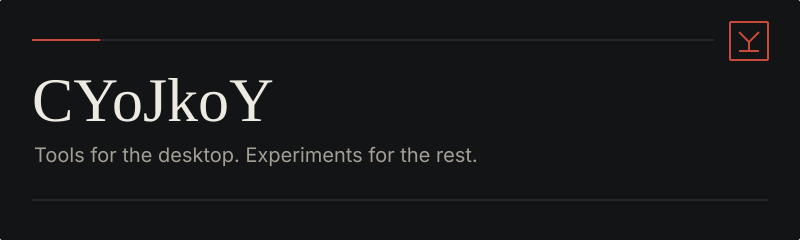
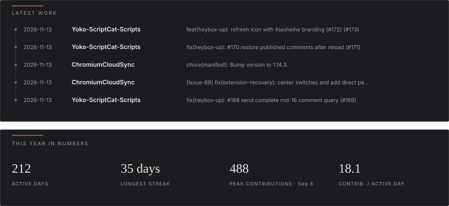

  

I make Windows utilities, browser extensions, and game mods. This is a selection of the projects I work on.

## The collection

<!-- REPO_LIST:START -->
#### Desktop & system

  
  
  
  

#### Extensions & developer tools

  
  
  

#### Mods & games

  
  
  
  
  

#### References

  

<!-- REPO_LIST:END -->

## Contribution activity

  <picture>
    <source media="(prefers-reduced-motion: reduce)" srcset="./assets/commit-activity-static.svg" />
    
  </picture>

  

[All repositories](https://github.com/CYoJkoY?tab=repositories)
