

# CYoJkoY

**Systems, Developer Tooling & Contract-Driven Engineering**

  
  
  
  

---

### ⚡ Philosophy & Engineering Discipline

> Pursuing minimal cognitive overhead, high information density, and zero-runtime-cost native interactions. Enforcing contract-driven architecture, surgical refactoring, and framework-free native stacks.

---

### 🛠️ Projects & Toolchains

<!-- REPO_LIST:START -->
#### Desktop & System Infrastructure

  <a href="https://github.com/CYoJkoY/CapsLock-">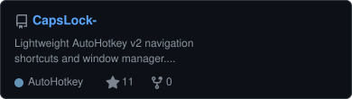</a>
  <a href="https://github.com/CYoJkoY/extras-">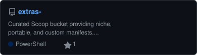</a>
  <a href="https://github.com/CYoJkoY/Yoko-Windhawk-Mods">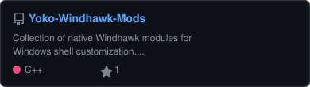</a>

#### Web Extensions & Developer Tools

  <a href="https://github.com/CYoJkoY/AiGithubIngest">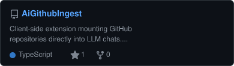</a>
  <a href="https://github.com/CYoJkoY/ChromiumCloudSync">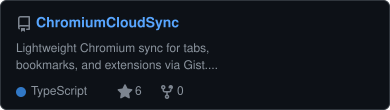</a>
  <a href="https://github.com/CYoJkoY/Neo-Godot-Tools">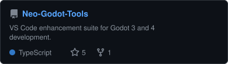</a>
  <a href="https://github.com/CYoJkoY/Yoko-ScriptCat-Scripts">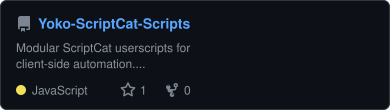</a>

#### Modding & Game Ecosystem

  <a href="https://github.com/CYoJkoY/Yoko-YzTato">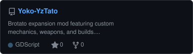</a>
  <a href="https://github.com/CYoJkoY/Yoko-NewContentLoader">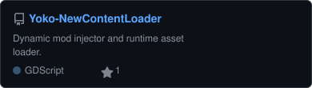</a>
  
  <a href="https://github.com/CYoJkoY/Yoko-Fantasy">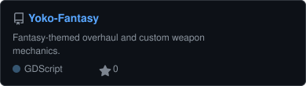</a>
  

#### Standards & Architecture

  <a href="https://github.com/CYoJkoY/AzSkills">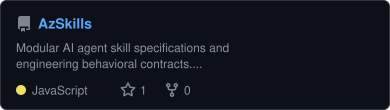</a>

<!-- REPO_LIST:END -->

---

### 📊 Activity & Metrics

  <picture>
    <source media="(prefers-color-scheme: dark)" srcset="https://raw.githubusercontent.com/CYoJkoY/CYoJkoY/output/github-contribution-grid-snake-dark.svg">
    <source media="(prefers-color-scheme: light)" srcset="https://raw.githubusercontent.com/CYoJkoY/CYoJkoY/output/github-contribution-grid-snake.svg">
    
  </picture>

---

  Built with precision, native performance, and engineering discipline.

